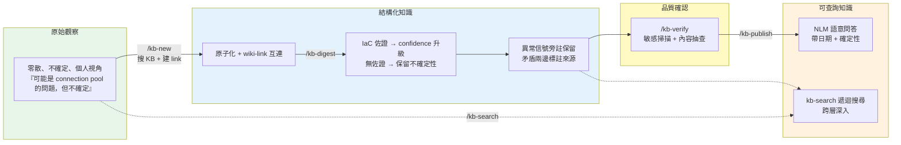

# AI Skills 自動化流程

## 什麼是 Skill？

Skill 是 Claude Code 的擴充功能——一個 `SKILL.md` 定義檔，描述 AI 的行為、可用工具、和執行步驟。

安裝後用 `/skill-name` 呼叫，就像 CLI 指令一樣。

### 安裝方式

```bash
# 安裝指定 skill
npx skills add <source> --skill <name> -a claude-code -g --copy

# 列出已安裝的 skill
npx skills list

# 更新所有 skill 到最新版
npx skills update
```

> `npx skills` 來自 [vercel-labs/skills](https://github.com/vercel-labs/skills)，是跨多種 AI 工具的 skill 套件管理工具。

### Skill 的結構

```
repo/.claude/skills/
└── kb-digest/
    └── SKILL.md    ← AI 的「劇本」
```

```yaml
---
name: kb-digest
description: 精煉原始筆記到 digest repo
allowed-tools: Read, Write, Edit, Glob, Grep, Bash
---

# 執行步驟
## Step 1: 準備工作區
...
```

## 知識的旅程：從觀察到可查詢

> 架構圖（[[architecture]]）看的是**東西放在哪**；這張圖看的是**知識經過什麼轉化**。



這個循環對應[[zettelkasten|卡片盒筆記法]]的三個核心原則：**原子化、互連、漸進累積**。差別在於，傳統卡片盒靠人力建連結，我們讓 AI 接手這些重複勞動。

---

## 6 個 Knowledge Base Skills

| Skill | 一句話 |
|-------|--------|
| [[skill-kb-search\|/kb-search]] | 遞迴搜尋——RAG 定位 + RLM 深入，LLM 自主決定下一步 |
| [[skill-kb-new\|/kb-new]] | 寫一張新卡片——搜 KB 建 link、判斷模板、問答補齊、自動 commit |
| [[skill-kb-digest\|/kb-digest]] | AI 精煉——增量處理、IaC 交叉驗證、矛盾保留、不確定性保留 |
| [[skill-kb-publish\|/kb-publish]] | 上傳 NotebookLM——按 category 合併、diff-based、敏感掃描 |
| [[skill-kb-verify\|/kb-verify]] | 品質驗證——格式合規 + 內容抽查，兩個獨立判定 |
| [[skill-kb-feedback\|/kb-feedback]] | 知識缺口分析——AI 主動告訴你缺什麼文件 |

→ 搜尋技術背景 [[search-concepts]]
→ NotebookLM 怎麼整合的？[[notebooklm-integration]]
→ 安全怎麼做的？[[security]]
→ 回到 [[index]]
