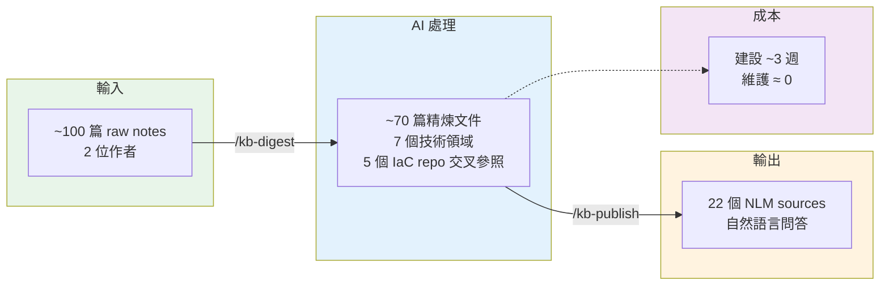

# 實際成果數據

## 目前規模

| 指標 | 數量 |
|------|------|
| 原始筆記 | ~100 篇 |
| 筆記作者 | 2 人 |
| 精煉文件 | ~70 篇 |
| 技術領域（categories） | 7 個 |
| IaC repo 交叉參照 | 5 個 |
| NotebookLM sources | 22 個（上限 50） |

## 技術領域分布

- Redis / ElastiCache
- ECS（容器部署）
- Networking
- IAM（權限管理）
- CI/CD / Git 工作流
- Configuration Management
- Knowledge Management（系統本身）

## AI 處理效率

| 操作 | 耗時 |
|------|------|
| `/kb-new`（建立一篇筆記） | 2-3 分鐘（含問答） |
| `/kb-digest`（增量精煉） | 5-15 分鐘（視筆記數量） |
| `/kb-publish`（上傳 NLM） | 3-5 分鐘 |
| `/kb-feedback`（缺口分析） | 5-10 分鐘 |

## 知識庫建設投入

- 系統設計 + Skill 開發：~3 週
- 筆記撰寫：團隊成員日常累積（非專案時間）
- 維護成本：接近零（AI 自動精煉 + 上傳）

## 對團隊的價值

- **縮短問題排查時間**：[[motivation|過去翻 Slack 找 30 分鐘]]，現在問 [[notebooklm-integration|NLM]] 30 秒
- **降低知識流失風險**：人員異動時，知識留在系統裡
- **跨團隊知識共享**：非 DevOps 成員也能查詢基礎設施知識
- **持續改善迴圈**：[[skill-kb-feedback|/kb-feedback]] 自動偵測缺口，驅動補強

→ 6 個 Skill 怎麼運作？[[ai-skills]]
→ 回到 [[index]]
