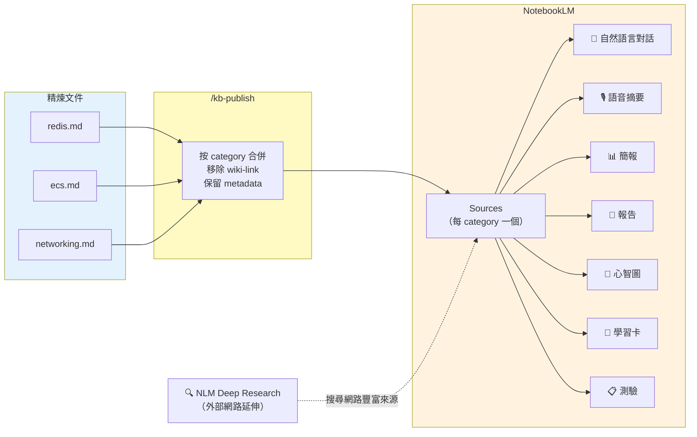

# NotebookLM 整合



## 為什麼選 NotebookLM

| 需求 | NotebookLM 能力 |
|------|----------------|
| 語意搜尋 | ✅ 理解自然語言問題 |
| 中文支援 | ✅ 中英文都行 |
| 非技術人員可用 | ✅ 網頁介面，不需要 CLI |
| 引用來源 | ✅ 回答時標註出處 |
| 免費 / 低成本 | ✅ Google 免費提供 |
| Deep Research | ✅ 搜尋網路延伸 source 知識 |
| 多元輸出 | ✅ 語音摘要、簡報、報告、心智圖、學習卡、測驗 |

## 整合方式

### `/kb-publish` 的合併策略

NotebookLM 的限制：
- 每個 notebook 最多 **50 個 sources**（Free tier；付費版可達 300）
- 每個 source 最多 **500,000 字元**
- **不支援更新**（只能刪除 + 重新建立）
- 不支援嵌入圖片

因此 `/kb-publish` 會：
1. 按 `categories` 合併精煉文件（每個 category → 一個大 md 檔）
2. 移除 `[[wiki-link]]` 語法（NLM 不認得）
3. 檢查字元數（超過 500K → 阻塞，建議拆分 category）
4. Diff 比對只上傳有變更的 category

### 兩種 Notebook

| | DevOps 分析師 | DevOps 小幫手 |
|---|---|---|
| 來源 | Digest 精煉文件 | Library 共享文件 |
| 內容 | 深度技術 Q&A | 跨團隊共享文件查找 |
| 指令 | `/kb-publish` | `/kb-publish --target library` |

### 操作方式

上傳後，任何人都可以在 NotebookLM 網頁介面：
- 用中文問問題，AI 回答並標註引用來源
- 用 Deep Research 搜尋網路延伸知識
- 一鍵產出：語音摘要、簡報、報告、心智圖、學習卡、測驗

### nlm CLI

也可以用命令列操作（適合自動化）：

```bash
# 列出 sources
nlm source list <notebook-id>

# 問問題
nlm notebook query <notebook-id> "Redis timeout 怎麼處理？" | jq -r '.value.answer'

# 上傳新 source
nlm source add <notebook-id> --text "$(cat file.md)" --title "標題"
```

> `nlm` CLI 是 notebooklm-mcp-cli，支援 MCP（Model Context Protocol）整合。

## 使用情境

### 情境 1：新人 on-boarding
> 「我們的 ECS 部署架構是什麼？」
→ NLM 從精煉文件中整理出完整架構說明

### 情境 2：值班排障
> 「Redis timeout 之前怎麼處理的？」
→ NLM 回答根因分析 + 解決方案 + 設定參數

### 情境 3：PM 了解技術細節
> 「我們的 IAM 權限管理原則是什麼？」
→ NLM 用非技術語言解釋操作原則

→ 上傳流程詳見 [[skill-kb-publish|/kb-publish]]
→ 三層架構中的第三層 [[architecture]]
→ 安全怎麼保障？[[security]]
→ 回到 [[index]]
