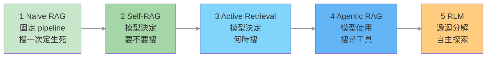
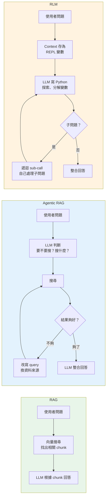
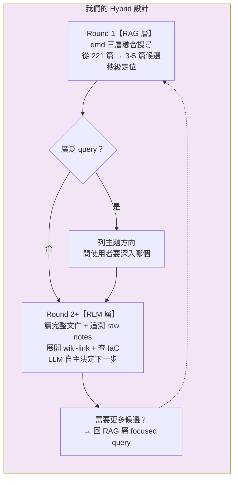

# 搜尋技術：RAG → Agentic RAG → RLM

## 演化光譜



```
  系統決定 ◄──────────────────────────────────► 模型決定
  被動接收結果                                      主動設計搜尋策略

                          ▲
                      我們在這裡
                     （層級 3-4）
```

## 三個名詞一張圖



## 白話解釋

### RAG（Retrieval-Augmented Generation）

「先找再答」——把使用者的問題拿去搜資料庫，找到相關段落，再讓 LLM 根據這些段落回答。

- **優點**：快、穩定、架構簡單
- **弱點**：chunk 斷章取意（300 token 的片段失去前後文）、搜一次就定生死

### Agentic RAG

「找不好就再找」——LLM 不只被動接收搜尋結果，還能主動：
- 決定要不要搜（有些問題不需要 retrieval）
- 評估結果品質（不好就改寫 query 重搜）
- 切換資料來源（這邊找不到，換個地方找）
- 多步推理（先搜 A 的結果用來搜 B）

### RLM（Recursive Language Models）

「模型自己寫程式碼探索」——最激進的一端。把 context 存為 REPL 環境中的變數，LLM 寫任意 Python 程式碼來檢視、分解這個變數，遇到子問題就遞迴呼叫自己（`llm_query`）處理。

- **核心機制**：context → REPL 變數 → LLM 寫 code 探索 → 遞迴 sub-call
- **優點**：能處理超過 context window 100 倍的輸入、有完整上下文不跑偏
- **弱點**：compute 成本高、對小量文件殺雞用牛刀

## 我們的 /kb-search 在哪裡



**定位：光譜的層級 3-4 之間**

| | 純 RAG | 我們的 /kb-search | 純 RLM |
|---|---|---|---|
| 定位速度 | ✅ 秒級 | ✅ 秒級（RAG 層） | ❌ 逐篇探索 |
| 理解深度 | ❌ chunk 斷章取意 | ✅ 讀完整文件（RLM 層） | ✅ 完整上下文 |
| 搜尋策略 | 固定 pipeline | LLM 自主決定 | LLM 寫程式碼 |
| 跨文件追溯 | ❌ | ✅ wiki-link + sources | ✅ 遞迴呼叫 |

> **大顆粒用 RAG 加速定位，小顆粒用 RLM 精神深入理解。**

→ 回到 [[ai-skills]]
→ 回到 [[index]]
