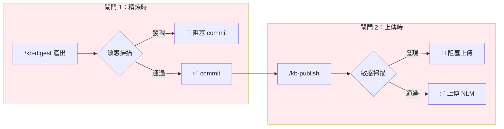

# 安全設計

知識庫包含基礎設施架構細節、操作指令、設定參數，安全是必要考量。

## 多階段敏感資訊掃描



兩道閘門，每道都是 **blocker**（不是 warning）。

### 掃描內容

- 密碼、API key、token、private key
- AWS access key / secret key
- 資料庫連線字串
- 內部 IP 位址
- 其他正則匹配的敏感模式

### 掃描方式

```bash
# verify-digest.sh / verify-publish.sh
grep -rniE "(password|secret|token|api[_-]?key|private[_-]?key)" .
grep -rniE "AKIA[0-9A-Z]{16}" .   # AWS Access Key
grep -rniE "[0-9]{1,3}\.[0-9]{1,3}\.[0-9]{1,3}\.[0-9]{1,3}" .  # IP
```

## [[skill-kb-verify|/kb-verify]] 品質驗證

獨立的驗證 skill，可以在任何時候執行。報告分為**格式合規**和**內容品質**兩個區塊：

### 格式合規

| 檢查項目 | 嚴重度 |
|---------|--------|
| 敏感資訊掃描 | 🔴 Blocker |
| Frontmatter 完整性 | 🟡 Advisory |
| Wiki-link 孤立連結 | 🟡 Advisory |
| NLM source 數量比對 | 🟡 Advisory |

### 內容品質（抽查）

| 檢查項目 | 嚴重度 |
|---------|--------|
| 不確定性保留（raw vs digest 比對） | 🟡 Advisory |
| confidence 欄位一致性 | 🟡 Advisory |
| NLM 正向 smoke test（已知答案） | 🟡 Advisory |
| NLM 負向 smoke test（偵測幻覺） | 🟡 Advisory |

格式合規的 Blocker 會阻止流程繼續；內容品質全部為 Advisory。
兩個區塊獨立判定——「格式通過 ≠ 內容品質沒問題」。

→ 回到 [[index]]
→ 看整體架構 [[architecture]]
