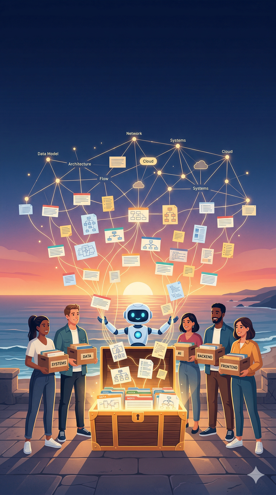
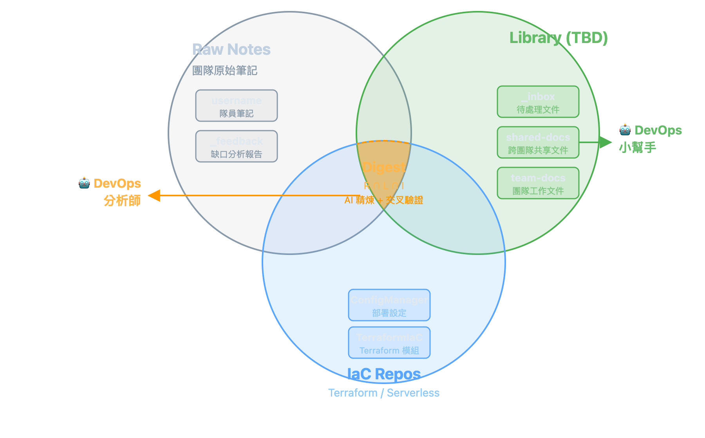
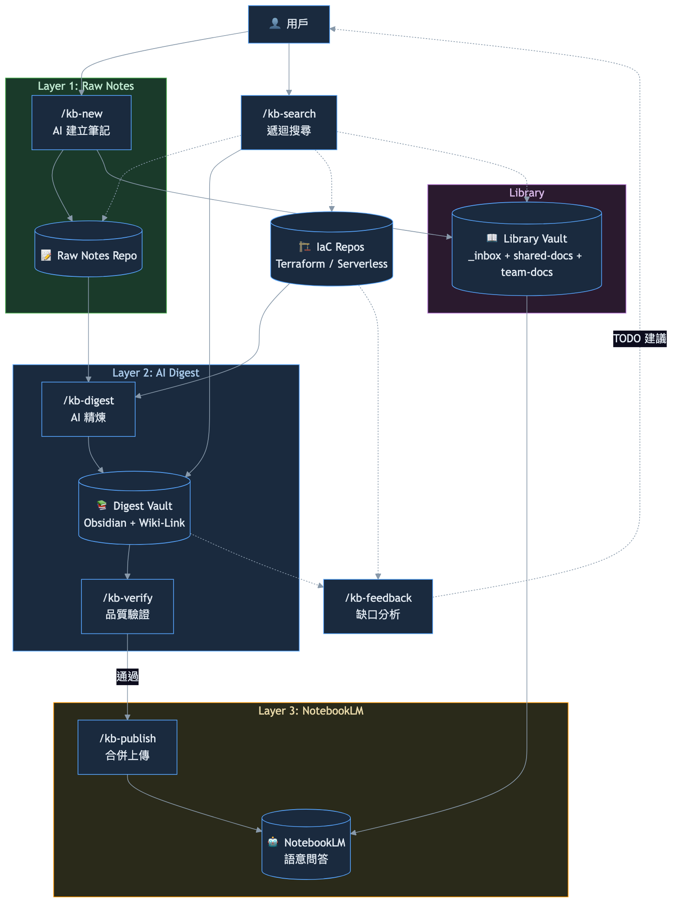

<!-- _class: lead -->

# 去找吧！我把所有的一切都放在那裡了！

> **AI 驅動的團隊知識管理系統**
> Tech Share 2025/03/31 · 20 min



---

# 今天的旅程

1. **為什麼做這件事** — 三個痛點
2. **卡片盒筆記法** — 站在巨人肩上
3. **知識範圍與架構** — 三圈交集 × 三層設計
4. **搜尋技術演化** — RAG → RLM
5. **AI Skills** — 6 個自動化技能
6. **NotebookLM 整合** — 語意問答
7. **安全設計** — 敏感資訊掃描
8. **Takeaway** — 三件事帶走

---

<!-- _class: lead -->

# 為什麼做這件事？

---

# 三個痛點

### 😩 找資料翻六七個工具花半天
新專案啟動，得翻 Confluence、Slack、Jira、Wiki、Git、Google Drive⋯⋯

### 🔄 同一個坑不同人反覆踩
三個月前有人踩過，但沒人知道筆記在哪

### 📝 寫文件門檻高到沒人想寫
要分類、要排版、要放對地方——結果就是沒人寫

---

# 核心答案

## 零摩擦輸入 + AI 自動加工

|  | 文件庫 | **知識庫** |
|--|--------|-----------|
| 輸入成本 | 高（要分類排版） | **低（寫就對了）** |
| 連結 | 手動維護 | **AI 自動建立** |
| 過時偵測 | 沒有 | **AI 偵測** |
| 搜尋 | 關鍵字 | **語意理解** |

> **人記錄觀察，AI 讓它變有用**

---

<!-- _class: lead -->

# 卡片盒筆記法
### Zettelkasten

---

# 三大核心原則

### 🧩 原子化 Atomicity
一張卡片只講一件事，才能被靈活組合

### 🔗 互連 Connectivity
卡片之間用連結串起脈絡，形成知識網路

### 📈 漸進累積 Progressive accumulation
每天加一點，知識自然成長——永遠寫新卡片，不改舊的

> Niklas Luhmann 用這套方法寫了 **70 本書**
> 瓶頸是建連結的人力成本——**AI 解決這個**

---

# AI 時代的升級

```
閃念筆記（Raw Note）
    ↓  AI 精煉
文獻筆記（整合多來源）
    ↓  AI 建連結
永久筆記（Digest）── wiki-link ──→ 相關卡片
```

- **不確定性保留**：AI 不會把「可能是 X」改成「確定是 X」
- **Append-only**：修正觀點時寫新卡片，保留思考演變
- **confidence 欄位**：標記確定性（單次觀察 / 多次觀察 / IaC 佐證）

---

<!-- _class: lead -->

# 知識範圍

---

# Digest = Raw Notes ∩ Library ∩ IaC Repos



---

<!-- _class: lead -->

# 系統架構

---



---

# 各層職責

| 層 | 功能 | 技術 |
|---|------|------|
| **Layer 1: Raw Notes** | 團隊成員寫筆記 | Git repo + Markdown |
| **Layer 2: AI Digest** | AI 精煉、建連結、交叉驗證 | Claude Code + Obsidian |
| **Layer 3: NotebookLM** | 自然語言問答 | Google NotebookLM |

跨層查詢：`/kb-search` 從精煉文件 → 原始筆記 → IaC 程式碼

---

<!-- _class: lead -->

# 搜尋技術演化

---

# 從 RAG 到 RLM

| 層級 | 技術 | 特點 |
|------|------|------|
| L1 | Naive RAG | 搜一次定生死 |
| L2 | Advanced RAG | 多次改寫查詢 |
| L3 | **Agentic RAG** | LLM 自主決定搜尋策略 |
| L4 | **RLM** | 遞迴自主探索 |

### 我們的定位：L3-L4 混合

- **大顆粒**用 RAG 快速定位（秒級）
- **小顆粒**用 RLM 精神深入（讀完整文件、追溯 wiki-link）

---

<!-- _class: lead -->

# AI Skills 自動化

---

# 知識旅程

```
觀察 ──→ 結構化 ──→ 品質確認 ──→ 可查詢知識
 │         │          │           │
/kb-new  /kb-digest  /kb-verify  /kb-publish
                                     ↓
                                  NotebookLM
         /kb-search ←── 遞迴搜尋 ───┘
         /kb-feedback ── 缺口分析 ───→ 持續改善
```

---

# 6 大 Skill

| Skill | 功能 | 亮點 |
|-------|------|------|
| `/kb-new` | 建立新卡片 | 自動搜 KB、建 link、commit |
| `/kb-search` | 遞迴搜尋 | AI 自主決定搜尋深度 |
| `/kb-digest` | AI 精煉 | IaC 交叉驗證、不確定性保留 |
| `/kb-publish` | 上傳 NLM | 保留日期和確定性 |
| `/kb-verify` | 品質驗證 | 抽查內容 + 負向 smoke test |
| `/kb-feedback` | 缺口分析 | 偵測知識盲區 |

> 安裝：`npx @anthropic-ai/claude-code-skills`

---

<!-- _class: lead -->

# NotebookLM 整合

---

# 為什麼選 NotebookLM

- ✅ **語意搜尋** — 不只關鍵字比對
- ✅ **中文支援** — 繁中問答流暢
- ✅ **非技術人員可用** — 自然語言，不需學工具
- ✅ **引用來源** — 每個答案指向原始文件
- ✅ **多元輸出** — 語音摘要、簡報、學習卡、測驗

### 兩個 Notebook

| Notebook | 來源 | 用途 |
|----------|------|------|
| 🤖 DevOps 分析師 | Digest（精煉文件） | 技術問答 |
| 🤖 DevOps 小幫手 | Library（共享文件） | 日常查詢 |

---

<!-- _class: lead -->

# 安全設計

---

# 雙閘門敏感掃描

### 🔒 閘門一：精煉時（阻塞 commit）　　🔒 閘門二：上傳時（阻塞上傳）

掃描：密碼 · API Key · Token · Private Key · AWS Key · DB 連線字串 · 內部 IP

---

# 品質驗證（/kb-verify）

| 類型 | 等級 | 效果 |
|------|------|------|
| 格式合規 | **Blocker** | 不通過就不發布 |
| 內容品質 | **Advisory** | 提出建議 |

---

<!-- _class: lead -->

# Takeaway


---

# 三件事帶走

### 1️⃣ 瓶頸不在「沒人寫」，在「寫完後的事」
AI 接手連結、精煉、偵測過時

### 2️⃣ AI 只是輔助
做重複勞動，**你的第一手觀察最有價值**

### 3️⃣ 永遠寫新卡片，不改舊的
知識的演變本身就有價值

---

# 最低啟動成本

## 一個 Git repo + 一份 Markdown

就這樣。

> **你只要記下來，AI 讓它變有用。**

---

<!-- _class: lead -->

# 附錄

---

# 實際成果數據 — 規模

| 指標 | 數字 |
|------|------|
| 原始筆記 | ~100 篇 |
| 精煉文件 | ~70 篇 |
| NLM sources | 22 個 |
| 技術領域 / IaC repo | 7 個 / 5 個 |

---

# 實際成果數據 — 效率

| 操作 | 耗時 |
|------|------|
| `/kb-new` | 2-3 分鐘 |
| `/kb-digest` | 5-15 分鐘 |
| `/kb-publish` | 3-5 分鐘 |
| 問題排查 | **30 分鐘 → 30 秒** |

---

# 工具鏈

| 類別 | 工具 |
|------|------|
| AI 引擎 | Claude Code + Skills |
| 編輯器 | Obsidian（wiki-link + graph view）|
| 問答前端 | Google NotebookLM |
| 版本控制 | Git + Gitea |
| 上傳工具 | nlm CLI（支援 MCP）|
| 圖表 | Mermaid |

---

<!-- _class: lead -->

# Q&A

有興趣歡迎來聊 💬

https://github.com/jimc1682000/ai-kb
