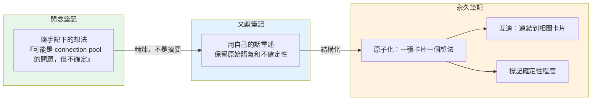

# 卡片盒筆記法

## 什麼是卡片盒筆記法

卡片盒筆記法（德文：Zettelkasten，意為「卡片盒」）是德國社會學家 Niklas Luhmann 發明的筆記方法。
他用這套方法在 30 年間寫了 70 本書和 400 篇論文。

### 三個核心原則

1. **原子化（Atomicity）**：每張卡片只記一個想法
2. **互連（Connectivity）**：卡片之間建立連結，形成網狀知識
3. **漸進累積（Emergence）**：新知識不斷加入，舊連結持續生長

### 為什麼有效

傳統筆記是「收藏」→ 寫下來就忘了。
卡片盒筆記法是「對話」→ 每次加入新卡片，都要思考它跟誰有關。

## 在我們系統中的體現

| 卡片盒原則 | KB 系統實作 |
|-------------------|-----------|
| 原子化 | 每篇 raw note 聚焦一個主題 |
| 互連 | AI 自動建立 `[[wiki-link]]` |
| 漸進累積 | 增量 `/kb-digest`，每次精煉只處理新內容 |
| 索引卡 | `categories` + `types` frontmatter |
| 永久筆記 | Digest 精煉文件 = 卡片盒的永久筆記 |
| 文獻筆記 | Raw notes = 卡片盒的文獻筆記 |

## 知識精煉：從原始觀察到永久筆記

卡片盒筆記法的核心不只是「記下來」，而是**精煉**——把零散的觀察轉化為可信賴的知識卡片。

**精煉的關鍵**：不是縮短，是提升可信度。

| | 摘要 | 精煉 |
|---|---|---|
| 目標 | 縮短 | 提升可信度 |
| 不確定性 | 通常被省略 | **刻意保留** |
| 矛盾 | 取其一 | **兩邊保留，標註來源** |
| 異常觀察 | 當雜訊過濾 | **當信號保留** |

> 「可能是 X」精煉後還是「可能是 X」——除非有其他證據能佐證。
> 這是精煉和摘要最大的差別。

## 卡片盒是 Append-Only 的

卡片盒筆記法有一個常被忽略的原則：**幾乎不修改既有卡片，永遠寫新卡片**。

| 場景 | 你以為的做法 | 卡片盒的做法 |
|------|------------|-------------------|
| 補充舊觀察 | 回去改那張卡片 | 寫一張**續卡**（Folgezettel）放在後面 |
| 發現寫錯了 | 刪掉重寫 | 寫新卡片修正，舊卡加註「見新卡」 |
| 一張卡片太大 | 直接拆開 | 從原卡**分支**（Verzweigung）出多張子卡 |
| 發現重複 | 合併成一張 | 寫一張**索引卡**串起來，原卡不動 |

為什麼不改？因為**舊卡片記錄了當時的理解**——保留它就是保留思考演變的歷史。

> 這對我們的系統意味著：raw note 永遠只新增（[[skill-kb-new|/kb-new]]），重整是 [[skill-kb-digest|/kb-digest]] 的工作。

## AI 時代的卡片盒筆記法

傳統卡片盒筆記法最大的瓶頸是**建立連結的人力成本**。
每寫一張卡片，要回顧所有相關卡片、手動建連結——當卡片超過幾百張，這變得不可能。

AI 改變了這個等式：

- **連結建立**：AI 讀過所有文件，自動找到相關主題建立 wiki-link
- **品質精煉**：AI 整合多人筆記，保留不確定性和異常信號，用 IaC 交叉驗證事實
- **過時偵測**：AI 比對時間戳和 IaC 程式碼，標記可能過時的內容
- **缺口分析**：AI 告訴你「哪些主題還沒有人寫」
- **反框架意識**：新筆記挑戰既有結論時，標記分歧而非靜默合併

本質上，AI 把卡片盒筆記法從「個人筆記法」升級成「團隊知識系統」——而且是一個**尊重不確定性**的知識系統。

→ AI 怎麼實現這些原則？[[ai-skills]]
→ 回到 [[index]]
